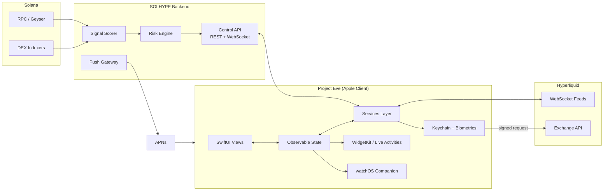
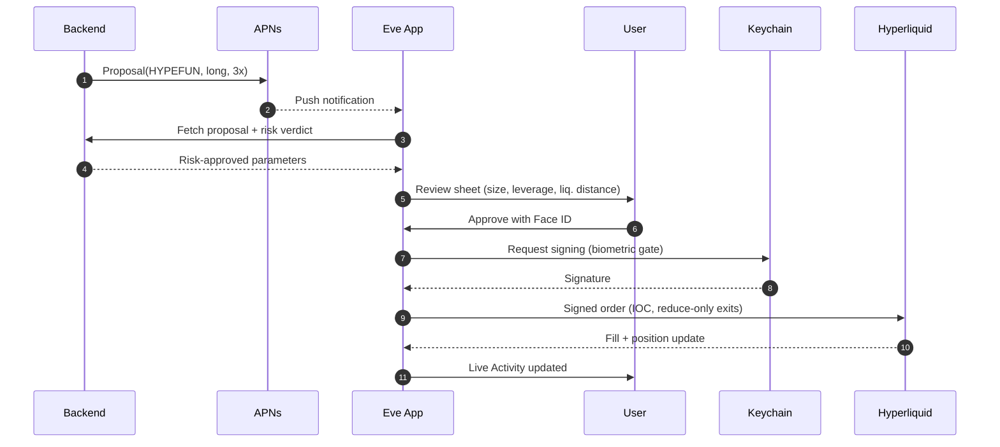
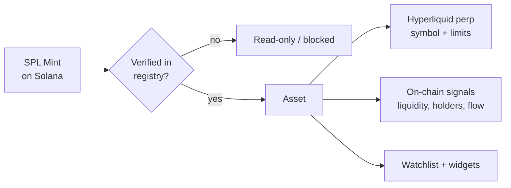
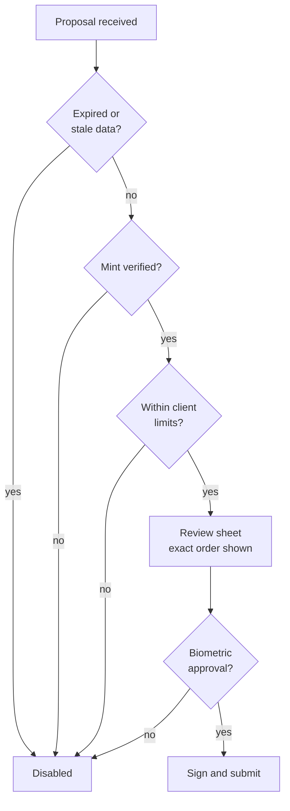
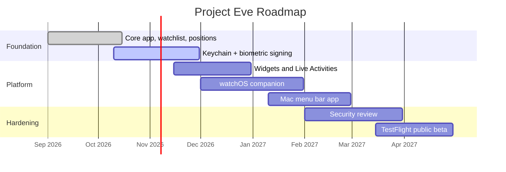

<div align="center">


# Project Eve: Native Memecoin Integration for Apple Platforms

**A native Apple-platform client for monitoring Solana low-cap memecoins and managing risk-bounded leveraged positions on Hyperliquid, built with SwiftUI and designed around the Apple security model.**

<br/>

[](#project-status-testing-phase)
[](#project-status-testing-phase)
[](#license)
[](#)
[](#risk-disclosure)

[](#)
[](#)
[](#)
[](#)
[](#)
[](https://solana.com)
[](https://hyperliquid.xyz)

<br/>

[**Overview**](#overview) ·
[**Architecture**](#architecture) ·
[**Platform Features**](#platform-features) ·
[**Security**](#security-model) ·
[**Quick Start**](#quick-start) ·
[**Config**](#configuration) ·
[**Compliance**](#app-store-and-compliance) ·
[**Roadmap**](#roadmap)

</div>

---

## Project Status: Testing Phase

> [!WARNING]
> **THIS PROJECT IS CURRENTLY IN A TESTING / EXPERIMENTAL PHASE.**
> It is a work in progress and has **not** been audited, battle-tested or validated for production use. Treat everything in this repository (code, configurations, risk parameters, UI flows and examples) as **experimental**.

| Area | Current State |
|---|---|
| Test wallet | `APPLcCCSuJR2HCio9FbLcjq3PGCynzwMkWs76Fz7wMhk` |
| Overall maturity | `v0.1.0-alpha`. Interfaces and configs may change without notice |
| Distribution | Local builds and **TestFlight** only. Not published on the App Store |
| Recommended mode | `paper`, then `testnet`. Do not use `live` with funds you cannot afford to lose completely |
| Key custody | Under security review. No independent audit has been performed |
| Widgets, Live Activities, watchOS | Prototype quality |
| Support | Best effort. Expect bugs, breaking changes and incomplete documentation |

---

> [!CAUTION]
> **EXTREME RISK.** Leveraged trading of low-market-cap memecoins can result in the **total and rapid loss of your entire capital**, including liquidation within seconds. This repository is a technical reference and is **not financial advice**. Read the [Risk Disclosure](#risk-disclosure) before connecting any wallet.

---

## Table of Contents

<details open>
<summary><b>Click to expand / collapse</b></summary>

1. [Overview](#overview)
2. [Design Principles](#design-principles)
3. [Architecture](#architecture)
4. [Platform Features](#platform-features)
5. [Memecoin Integration Layer](#memecoin-integration-layer)
6. [Security Model](#security-model)
7. [Quick Start](#quick-start)
8. [Configuration](#configuration)
9. [Core Interfaces](#core-interfaces)
10. [Notifications, Widgets and Live Activities](#notifications-widgets-and-live-activities)
11. [Risk Controls in the Client](#risk-controls-in-the-client)
12. [App Store and Compliance](#app-store-and-compliance)
13. [Testing](#testing)
14. [Roadmap](#roadmap)
15. [Contributing](#contributing)
16. [Risk Disclosure](#risk-disclosure)
17. [License](#license)

</details>

---

## Overview

**Project Eve** is the native Apple client of the SOLHYPE ecosystem. It brings Solana memecoin intelligence and Hyperliquid perpetual position management to iPhone, iPad, Mac and Apple Watch, using first-party frameworks instead of a web wrapper.

| Layer | Role |
|---|---|
| **Solana** | Signal source: pool activity, liquidity changes, holder distribution, smart-wallet flow |
| **Hyperliquid** | Execution venue: perpetual order books, margin, positions, funding |
| **Apple platforms** | Interface, secure key storage, biometric authorization, alerts, glanceable status |

The client does **not** run the full strategy engine on-device. A self-hosted SOLHYPE backend produces signals and runs the Risk Engine. The app is a **secure control and monitoring surface**: it displays state, lets the user approve or reject actions, and signs requests locally so private keys never leave the device.

```text
 ┌──────────────────────────────────────────────────────────────────────────┐
 │                                                                          │
 │   SOLANA data  ──►  SOLHYPE BACKEND  ──►  APPLE CLIENT  ──►  HYPERLIQUID │
 │   on-chain flow     signals + risk        review + sign      perp orders  │
 │                                                                          │
 └──────────────────────────────────────────────────────────────────────────┘
```

---

## Design Principles

- **Native first.** SwiftUI, Swift Concurrency, Swift Charts, WidgetKit, ActivityKit and App Intents. No web views for core flows.
- **Keys stay on device.** Private keys are generated or imported locally, stored in the Keychain with biometric access control, and never sent to any server.
- **Human in the loop.** Every order that can open or increase risk requires explicit local authorization (Face ID or Touch ID).
- **Risk engine is not bypassable.** The client displays and enforces limits; it cannot override the backend Risk Engine.
- **Fail closed.** Stale data, lost connectivity or a breaker trip disables order entry instead of guessing.
- **Accessible by default.** Dynamic Type, VoiceOver labels, color-independent status indicators and Reduce Motion support.

---

## Architecture

### High-Level System



### Sequence: Reviewing and Authorizing a Trade



### Client Layers

| Layer | Responsibility | Technology |
|---|---|---|
| Presentation | Screens, navigation, charts | SwiftUI, Swift Charts |
| State | Observable view models, caching | Observation framework, SwiftData |
| Services | API client, WebSocket feeds, signing, push | URLSession, Swift Concurrency |
| Security | Key storage, biometrics, session lock | Keychain, LocalAuthentication, CryptoKit |
| Extensions | Widgets, Live Activities, intents, complications | WidgetKit, ActivityKit, App Intents |

---

## Platform Features

<table>
<tr>
<td width="50%" valign="top">

### iPhone and iPad
- Memecoin watchlist with live perp prices
- Signal feed with score breakdown
- Position dashboard (PnL, leverage, liquidation distance)
- Trade review sheet with Face ID authorization
- Swift Charts for price, funding and open interest
- Lock Screen and Home Screen widgets

</td>
<td width="50%" valign="top">

### Mac
- Menu bar status item with portfolio heat
- Multi-window layout for books and positions
- Keyboard shortcuts for pause and kill switch
- Touch ID authorization on supported hardware
- Notification Center integration

</td>
</tr>
<tr>
<td width="50%" valign="top">

### Apple Watch
- Glanceable equity and open risk
- Complications for position status
- Haptic alerts on breaker and liquidation warnings
- One-tap pause of new entries

</td>
<td width="50%" valign="top">

### System Integration
- Live Activities for open positions
- Interactive widgets (pause, view positions)
- App Intents for Shortcuts and Siri
- Focus-aware notification levels
- iCloud-synced settings (never keys)

</td>
</tr>
</table>

---

## Memecoin Integration Layer

The app treats each memecoin as a single **Asset** that links its Solana identity to its Hyperliquid market.



| Concern | Approach |
|---|---|
| Identity | The **SPL mint address** is the source of truth, never the ticker. Spoofed tokens with identical tickers are common |
| Market availability | Resolved at runtime from the Hyperliquid `meta` endpoint. Nothing is hard-coded |
| Tiering | Assets are tiered (T1 to T4). Tier controls max leverage and size in the client |
| Display | Mint is always shown truncated with a copy action and a full-address confirmation before any approval |
| Unverified tokens | Shown read-only. Order entry is disabled |

### Canonical Test Asset

The first canonical test runs on a single low-cap asset, **HYPEFUN**, in `paper` / `testnet` mode.

| Field | Value |
|---|---|
| Token | HYPEFUN |
| Mint (SPL) | `C4Uj6tm6BR1YveN1mtkE54zuN8QJomXYb5c2jFjuHYPE` |
| Mode | `paper` / `testnet` only |
| Goal | Validate the end-to-end flow on device: signal, review, authorization, signing, position tracking and alerts |

> [!NOTE]
> Verify the mint address independently before any interaction. Availability of a Hyperliquid market for this token has not been confirmed in this repository. If a proxy market is used for execution testing, document the symbol used.

---

## Security Model

| Topic | Design |
|---|---|
| Key storage | Keys live in the **Keychain** with `kSecAttrAccessibleWhenPasscodeSetThisDeviceOnly` and biometric access control. Items are not synced to iCloud Keychain |
| Secure Enclave | The Secure Enclave supports P-256 keys only. Solana (Ed25519) and Hyperliquid (secp256k1) keys cannot be generated inside it. Instead, a Secure Enclave P-256 key is used to **wrap** the signing keys at rest |
| Trading permissions | Use a Hyperliquid **API (agent) wallet** with trading permission only. **Never** import a main wallet key with withdrawal rights |
| Authorization | Face ID / Touch ID required for every risk-increasing order. Exits and kill switch can be configured for faster access |
| Session lock | Auto-lock on background, configurable timeout, blur in the app switcher |
| Transport | TLS only, certificate pinning for the control API, no cleartext traffic (ATS enforced) |
| Local data | Encrypted at rest with Data Protection (`complete` class). No keys or secrets in logs, crash reports or analytics |
| Jailbreak / tamper | Best-effort detection with a warning. Not relied on as a control |
| Telemetry | None by default. No third-party analytics SDKs |

```swift
// Biometric-gated signing key access (simplified)
import LocalAuthentication
import Security

func loadSigningKey() throws -> Data {
    let context = LAContext()
    context.localizedReason = "Authorize trade"

    let query: [String: Any] = [
        kSecClass as String: kSecClassGenericPassword,
        kSecAttrService as String: "com.example.eve.agent-key",
        kSecReturnData as String: true,
        kSecUseAuthenticationContext as String: context
    ]

    var item: CFTypeRef?
    let status = SecItemCopyMatching(query as CFDictionary, &item)
    guard status == errSecSuccess, let data = item as? Data else {
        throw KeyError.unavailable(status)
    }
    return data
}
```

| Threat | Mitigation |
|---|---|
| Device theft | Passcode-bound Keychain items, biometric gate, remote revoke of the agent wallet |
| Phishing / fake token | Mint-verified registry, full-address confirmation on approval |
| Malicious deep link | Strict allowlist and confirmation screen for any link-initiated action |
| Compromised backend | Client re-validates limits locally and shows the exact order before signing |
| Screen capture | Sensitive screens hidden in the app switcher and optionally blocked from capture |

---

## Quick Start

### Prerequisites

| Requirement | Version |
|---|---|
| Xcode | `16+` |
| Swift | `6.x` |
| iOS / iPadOS | `17+` |
| macOS | `14+` |
| watchOS | `10+` |
| Apple Developer account | Required for device builds, Live Activities and push |
| SOLHYPE backend | Running instance (see the main repository) |

### 1. Clone and Open

```bash
git clone https://github.com/your-org/project-eve.git
cd project-eve
open Eve.xcodeproj
```

### 2. Configure the Backend Endpoint

Create `Config/Local.xcconfig` (never commit this file):

```text
SOLHYPE_API_BASE_URL = https:/$()/your-backend.example
SOLHYPE_WS_URL = wss:/$()/your-backend.example/stream
HL_NETWORK = testnet
```

### 3. Set Signing and Capabilities

In Xcode, select your team and enable:

- Push Notifications
- Background Modes (remote notifications)
- App Groups (for widgets and Live Activities)
- Keychain Sharing (only if you add extensions that need it)

### 4. Run in Paper Mode First

```bash
# Build and run on a simulator
xcodebuild -scheme Eve -destination 'platform=iOS Simulator,name=iPhone 16' build
```

> [!IMPORTANT]
> Start with `paper`, then `testnet`. Use an API (agent) wallet with trading permission only. Never import a main wallet key.

---

## Configuration

```yaml
# Config/app-settings.yaml
mode: testnet                    # paper | testnet | live

client:
  require_biometrics_for_entries: true
  require_biometrics_for_exits: false
  session_lock_timeout_sec: 60
  hide_in_app_switcher: true

limits:
  max_leverage_client: 3         # client-side ceiling, never above backend
  max_notional_usd: 250
  confirm_full_mint_address: true
  block_unverified_tokens: true

notifications:
  signal_alerts: true
  min_signal_score: 0.80
  liquidation_warning_pct: 20    # warn when price is within X% of liquidation
  critical_alerts: true          # requires Apple critical-alert entitlement

live_activity:
  enabled: true
  update_interval_sec: 5

watch:
  haptics: true
  allow_pause_from_watch: true
  allow_open_from_watch: false   # entries never from the watch
```

---

## Core Interfaces

```swift
// Asset: links a Solana mint to its Hyperliquid market
struct Asset: Identifiable, Hashable, Sendable {
    let id: String              // SPL mint address
    let symbol: String
    let tier: Tier
    let hlSymbol: String?       // nil if no perp is available
    let isVerified: Bool

    enum Tier: String, Sendable { case t1, t2, t3, t4 }
}

// Proposal produced by the backend after the Risk Engine has approved it
struct TradeProposal: Identifiable, Sendable {
    let id: UUID
    let asset: Asset
    let side: Side
    let leverage: Int
    let notionalUsd: Decimal
    let stopLossPct: Decimal
    let takeProfitPct: Decimal
    let liquidationDistancePct: Decimal
    let expiresAt: Date         // proposals expire; stale ones cannot be signed

    enum Side: String, Sendable { case long, short }
}

// Services are protocol-based for testing and previews
protocol TradingService: Sendable {
    func proposals() -> AsyncStream<TradeProposal>
    func submit(_ proposal: TradeProposal, authorizedBy: AuthToken) async throws -> Fill
    func pauseEntries() async throws
    func killSwitch() async throws       // flatten all and lock
}
```

---

## Notifications, Widgets and Live Activities

| Surface | Purpose | Notes |
|---|---|---|
| Push (APNs) | New proposals, breaker trips, liquidation warnings | Backend sends only a proposal ID. Details are fetched in-app |
| Time Sensitive | Liquidation proximity and breaker events | Subject to the user's Focus settings |
| Critical alerts | Optional, for imminent liquidation | Requires a special Apple entitlement |
| Home / Lock Screen widgets | Equity, open risk, top position | Refresh budget is limited by the system |
| Interactive widgets | Pause entries, open positions | Entries are never opened from a widget |
| Live Activity | Open position PnL and liquidation distance | Updated via push or app activity |
| watchOS complications | Heat and status color | Color is never the only indicator |

> [!NOTE]
> Widgets and Live Activities are **not** real-time feeds. The system throttles updates, so they are glanceable indicators and must never be relied on for risk decisions. Positions must be protected by exchange-side stop and reduce-only orders.

---

## Risk Controls in the Client



- Proposals **expire**. An expired proposal cannot be signed.
- The review sheet always shows **size, leverage, stop, take profit and liquidation distance** before authorization.
- The client ceiling can only be **stricter** than the backend limits, never looser.
- Entry is disabled when feeds are stale, the backend is unreachable or a breaker is active.
- Exits are always **reduce-only**.
- The kill switch is reachable from the app, the Mac menu bar, the Watch and Shortcuts.

---

## App Store and Compliance

> [!IMPORTANT]
> Apps that facilitate crypto trading are subject to additional App Store rules and local regulation. Review the current **App Store Review Guidelines** (notably the sections on cryptocurrencies and financial services) and applicable law before distributing.

| Topic | Guidance |
|---|---|
| Distribution | TestFlight for the testing phase. A public release requires a review of regulatory status |
| Financial services | Apps that offer derivatives or trading are typically expected to come from an appropriately licensed organization. Verify requirements for your jurisdiction |
| Custody | The app is **non-custodial**. It does not hold or transmit user funds |
| Marketing | No profit claims, no guaranteed returns, no promotion of specific tokens |
| Content | Risk warnings are shown on first launch and before enabling `live` mode |
| Privacy | Privacy manifest and App Privacy details must match actual behavior. No tracking |
| Export compliance | The app uses encryption. Declare it correctly |
| Jurisdiction | Derivatives trading may be restricted or prohibited in your region. You are responsible for compliance |

---

## Testing

```bash
# Unit tests
xcodebuild test -scheme Eve -destination 'platform=iOS Simulator,name=iPhone 16'

# UI tests
xcodebuild test -scheme EveUITests -destination 'platform=iOS Simulator,name=iPhone 16'
```

| Suite | Scope |
|---|---|
| Unit | Models, limit checks, proposal expiry, formatting |
| Service | Mocked API and WebSocket (`TradingService` protocol) |
| Security | Keychain access control, biometric failure paths, session lock |
| UI | Review sheet, authorization flow, kill switch |
| Snapshot | Dynamic Type, dark mode, widgets, Live Activity |
| Accessibility | VoiceOver labels, contrast, Reduce Motion |
| Integration | Hyperliquid **testnet** end to end |

---

## Roadmap



- [x] Core app shell and navigation
- [x] Watchlist and position views
- [ ] Biometric-gated signing
- [ ] Widgets and interactive widgets
- [ ] Live Activities
- [ ] watchOS companion and complications
- [ ] Mac menu bar client
- [ ] App Intents and Shortcuts
- [ ] Independent security review

---

## Contributing

Contributions are welcome, especially in **security, accessibility and testing**.

```bash
git checkout -b feat/your-feature
swift test
git commit -m "feat(security): add session lock timeout"
git push origin feat/your-feature
```

1. Open an issue before large changes
2. Follow [Conventional Commits](https://www.conventionalcommits.org)
3. Any change touching key storage or signing **requires** new tests
4. No change that weakens a default safety limit will be merged without explicit maintainer sign-off

---

## Risk Disclosure

<div align="center">

### READ THIS CAREFULLY

</div>

- **Total loss is a realistic outcome.** Low-cap memecoin perpetuals combine extreme volatility, thin liquidity and leverage. Positions can be liquidated in seconds, and stops can gap or fail to fill.
- **Not financial advice.** This software and documentation are provided for educational and technical purposes only.
- **Testing phase.** This is an experimental client. Bugs, API changes and misconfiguration can cause losses.
- **Mobile limitations.** Connectivity loss, background restrictions, battery saver modes and system throttling can delay or prevent updates and actions. Do not rely on a phone as the only protection for open positions.
- **No guarantees.** Examples and figures are illustrative. Past performance does not predict future results.
- **Market integrity risks.** Memecoin markets are prone to manipulation, rug pulls, spoofed tokens and sudden delistings or leverage changes by the venue.
- **Regulatory risk.** Derivatives trading may be restricted or prohibited in your jurisdiction. You are solely responsible for compliance.
- **Only risk what you can afford to lose completely.**

The authors and contributors accept **no liability** for any loss or damage arising from use of this software.

---

## License

Released under the **MIT License**. See [`LICENSE`](./LICENSE).

<div align="center">

<br/>


**Built for operators who respect risk.**

Star this repo if it's useful · Open an issue · Report vulnerabilities privately

</div>
